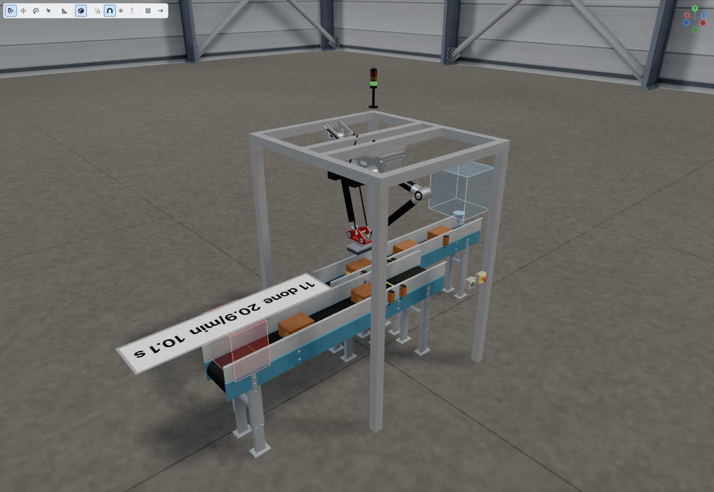

# DuoPod transfer cell in Open Industry Project

A ceiling-mounted 2-axis parallel robot (modelled on the Autonox DuoPod) moves 3 kg cartons one at a time from an
infeed belt to the outfeed belt beside it. The cell is built in [Open Industry Project](https://openindustryproject.org)
(OIP), a free, MIT-licensed browser simulator with Jolt physics and a built-in IEC 61131-3 PLC. The robot is a custom
OIP part, and an ST program drives it through a handshake, the way a real PLC would.



## Open it

- **In the browser:** go to [openindustryproject.org/app](https://openindustryproject.org/app), choose **Import Project**
  and pick [`dist/duopod-cell.scene.json`](dist/duopod-cell.scene.json). Press Play, then the green START button on the
  operator panel.
- **As a project folder:** this repository *is* the OIP project folder (`project.json`, `scene.json`, `plc/`, `parts/`,
  `tests/`). The OIP desktop app opens it directly.

## What is in the cell

| | |
|---|---|
| Infeed A1 | accumulation belt, 0.4 m/s, 220 mm guides |
| Pick belt A2 | 0.6 m/s; the faster belt opens the gap the escapement blade rises into |
| Escapement | `oip.blade-stop` at the A1/A2 junction (PLC-driven) + a fixed end stop under the robot |
| Outfeed B | 0.4 m/s, ending in a despawner that counts deliveries (`Delivered`) |
| Cartons | 250 × 180 × 120 mm, 3 kg, from a box spawner gated by the PLC (queue full = carton standing at `EyeFull` for 1 s) |
| Photo-eyes | `EyeStop`, `EyeZone`, `EyeGate` (pick lane), `EyeHead` (queue head), `EyeFull`, `EyeB0`/`EyeB1` (drop zone on B) |
| Operator | E-STOP (normally closed, `EStopOk`), START, stack light |
| Robot | `parts/duopod.transfer-robot`, our own procedural model (Draco GLB, 1.1 MB) |

### The robot part

The robot is a rig part with one mesh per moving body. Every tick it turns the TCP into joint angles (5-bar inverse
kinematics) and poses the upper arms, lower arms, plate and both orientation rods from the result. The dimensions are
motor axes ±125 mm, upper arms 450 mm, lower arms 930 mm and plate joints ±90 mm. Moves are minimum-jerk goal-post
moves at the DuoPod cycle timings.

| Tag (default) | Dir | Meaning |
|---|---|---|
| `RobotCmd` | in | point row: 1 ready, 2 pick, 3 place |
| `RobotExecute` | in | rising edge starts the move (hold it until `RobotBusy`) |
| `RobotDone` / `RobotBusy` / `RobotPoint` | out | standing on a point / moving / the row it stands on |
| `Vacuum` / `VacuumOk` | in / out | vacuum command (latched only at standstill) / the gripper really holds a load |
| `RobotEnable` | in | low holds the motion where it is |
| `RobotX`, `RobotZ` | out | actual TCP, mm (across the belts, above the belt top) |

The point table, travel height and a motion time scale are part parameters.

### The PLC program (`plc/program.st`)

- **Escapement.** The blade drops only when the pick lane is empty (`EyeGate`, `EyeZone` and `EyeStop` all clear) and
  the robot is clear of the infeed column (TCP over belt B or above 250 mm). The released carton accelerates on A2.
  When `EyeHead` sees the gap, A1 stops, the blade rises into the gap, and A1 runs again.
- **Robot cycle.** ready → wait until a carton has settled at the stop → pick → vacuum, wait for `VacuumOk` → wait
  until the drop zone on B is clear → place → release → ready.
- **Supervision.** `ColumnAlarm` latches if the blade is ever open while the TCP is low over the infeed column. It
  stops the line, and START clears it.
- **Safety.** The E-stop drops `Running`, every belt and the feed, and the robot holds where it is. The vacuum stays
  on, so a carried carton is not dropped. **Releasing the E-stop restarts nothing; START does.** The stack light is
  green when running, amber when stopped and red on E-stop.

## Tests

Run from a checkout of OIP (pinned below):

```sh
cd open-industry-project
P=/path/to/duopod-cell-oip
npm run check-part -- $P/parts/duopod.transfer-robot
npm run validate-project -- $P --strict
npm run check-st -- $P/plc
npm run check-wiring -- $P --strict
npm run check-layout -- $P
npm run test-project -- $P
OIP=$PWD $P/tools/perturb.sh     # the tests must FAIL on mutated programs
```

| Test | What it asserts |
|---|---|
| `transfer` | ≥ 14 cartons delivered in 40 s (counted by the program and by a world probe on belt B), ≥ 17 picked, no carton ever on the floor, never more than one carton in the pick lane |
| `escapement-interlock` | `ColumnAlarm` never fires, the blade really cycles, ≥ 15 picked, one carton at a time in the pick lane |
| `safety` | E-stop mid-transfer (OIP `sensorStuck` fault on the NC contact): the robot holds its TCP to ±0.5 mm and keeps the carton, belts and feed stop, the light turns red; releasing the E-stop keeps everything stopped (amber); START resumes and picking continues |

`tools/perturb.sh` runs the suite on two mutants of the program. With the escapement interlock removed, three tests
fail. With the restart lock removed (`RobotEnable` following the E-stop contact), `safety` fails. The script exits 0
only if both mutants are caught.

**Measured throughput:** 2.0 s steady cycle (about 30 cartons/min), 16 delivered in the first 40 s. The robot is
back at ready before the next carton has settled, so the carton path limits the rate, not the robot.

These are OIP's own physics (Jolt) and PLC engine. The results are comparable with the MuJoCo and duopod-cell-pro
twins, not identical to them. Nothing here is physically validated.

## Rebuilding

| Script | Does |
|---|---|
| `tools/make_part.sh` | export the procedural model from duopod-cell-pro (`?cad=0`), weld + Draco, write the part |
| `tools/build_scene.sh` | lay the whole scene out with OIP's `add-part` (every parameter checked), bind `plc/` and `tests/` |
| `tools/scene_file.mjs` | write `dist/duopod-cell.scene.json`, the one-file scene for Import Project |
| `tools/record.mjs` | stills + MP4 of the cell running in the local OIP editor (Playwright) |

The scripts expect the OIP checkout at `~/code/_vendor/open-industry-project`; set `OIP=` to use another location.

**Pinned OIP commit:** [`7ed2b7d`](https://github.com/Open-Industry-Project/Open-Industry-Project/commit/7ed2b7dbf01835365ba3432bbdd84d933a843dde)
(2026-11-19). OIP is an early release and its formats may change.

## Licences and disclaimer

- `parts/oip.*` are the project's copies of OIP built-in parts, MIT © Automation Standard LLC and Contributors, see
  [`parts/LICENSE-OIP`](parts/LICENSE-OIP).
- The robot model is our own procedural model built on measured dimensions. No vendor CAD is published or used here.
- This project is not affiliated with Autonox or with Open Industry Project. Autonox and DuoPod are trademarks of
  their owners.
